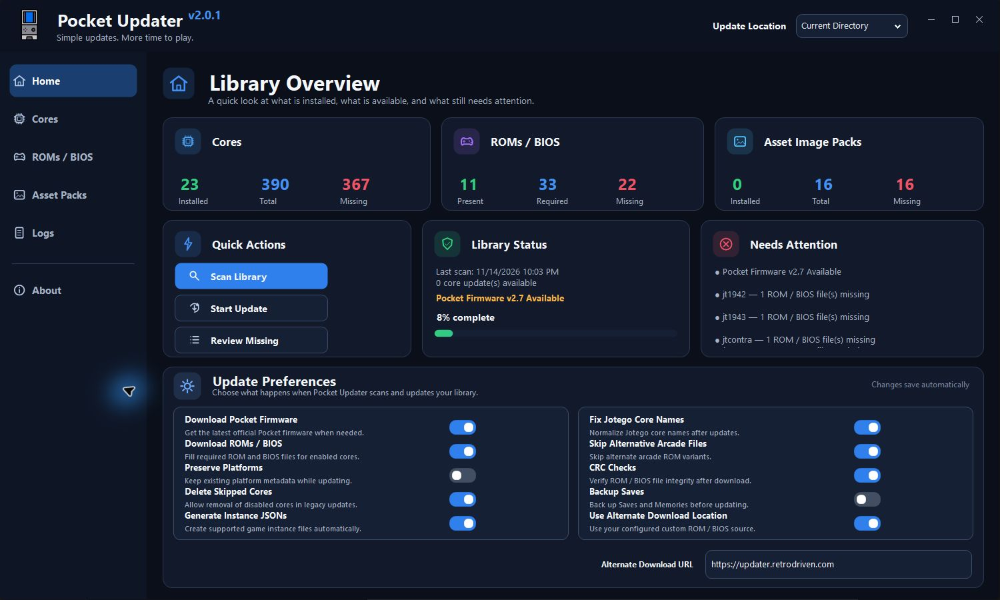
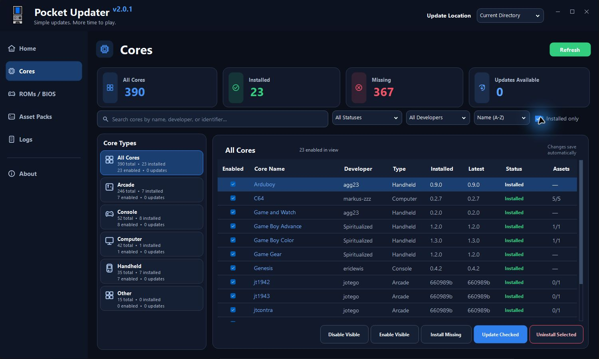
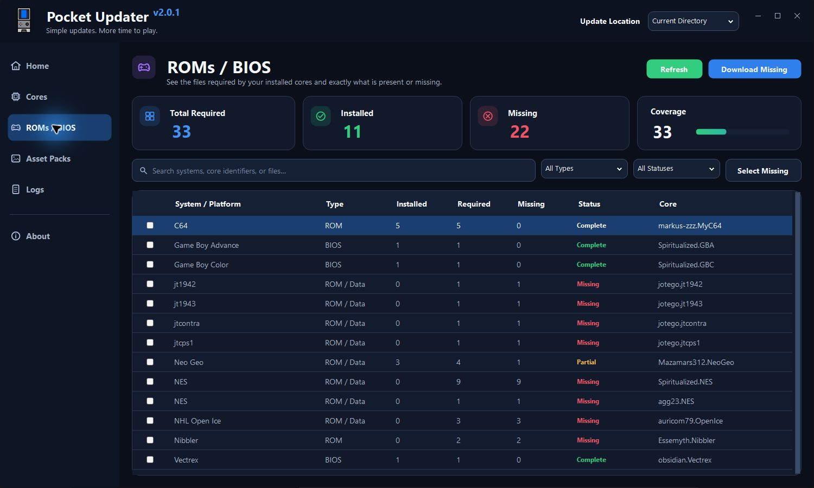
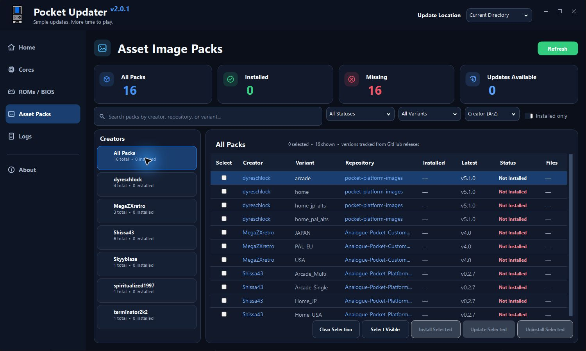
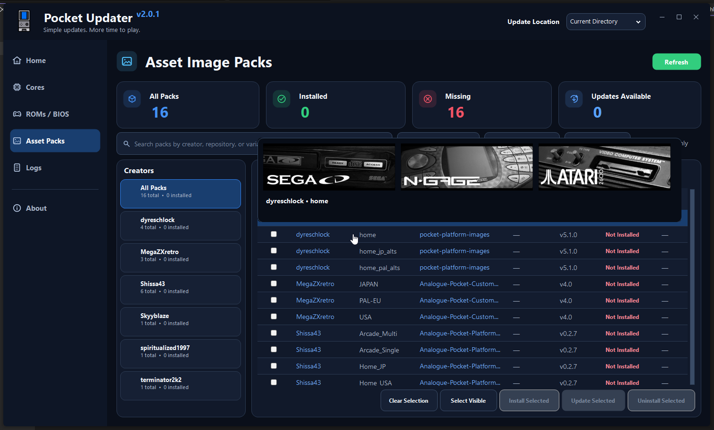
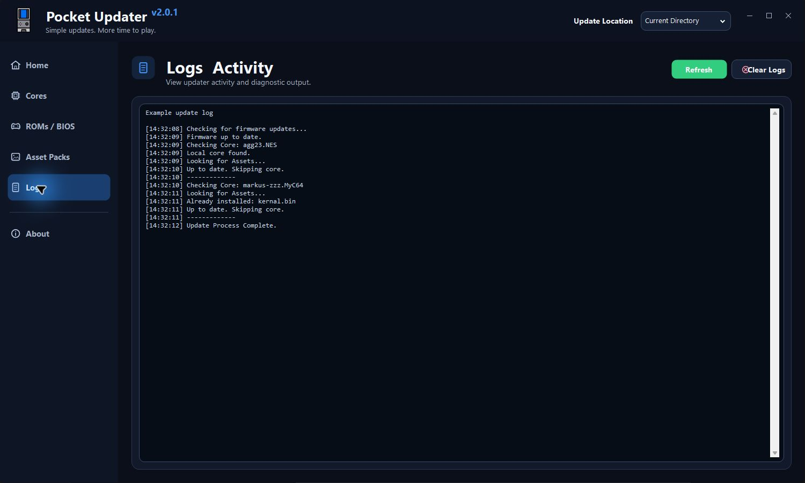
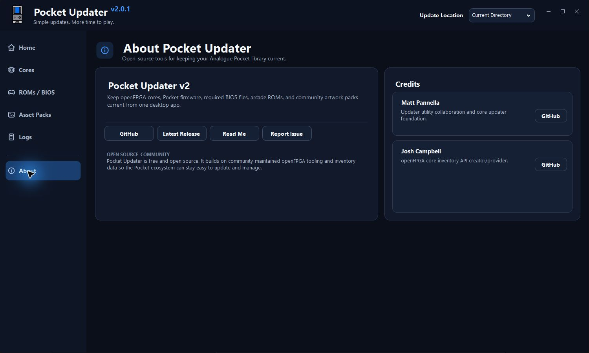

## Analogue Pocket Updater - Windows Application ##
     

This is a free Windows Application for updating the openFPGA Cores, Pocket Firmware, Required BIOS, and Arcade ROMS for your Analogue Pocket. You can also Organize your Cores and Download/Install Asset Image Packs.

This Application can be run from the Pocket's SD Card or from any location on your Windows Machine based on what fits your needs best.

## Bulding Exe from Source ##
Please note that the following dependencies below are required if you plan to edit/build the EXE from Source via Visual Studio.

[Crc32.NET](https://www.nuget.org/packages/Crc32.NET)

[Guna.UI2.WinForms](https://www.nuget.org/packages/Guna.UI2.WinForms)

## Updating

Choose an **Update Location** in the top bar.

- **Current Directory** updates the folder where Pocket Updater is running. You can copy the updated files to your Pocket's SD card afterward.
- **Removable Storage** updates the selected drive directly. Connect your Pocket or insert its SD card, then choose the drive. Use the refresh button beside the drive list if it does not appear.

On **Home**, click **Scan Library** to refresh the overview. **Review Missing** opens the ROMs / BIOS view. Click **Start Update** to update your enabled cores and download firmware or assets according to your preferences. The progress window shows what was installed or skipped.

Screenshots show Pocket Updater v2.0.1 with an example library.

## Update Preferences

The switches on **Home** save automatically.

| Setting | What it does |
| --- | --- |
| Download Pocket Firmware | Checks for and downloads official Pocket firmware. |
| Download ROMs / BIOS | Looks for missing ROMs and BIOS files for enabled cores in the configured source. |
| Preserve Platforms | Keeps existing platform metadata and artwork while updating. |
| Delete Skipped Cores | Allows removal of disabled cores in legacy updates. **Start Update** keeps installed cores. |
| Generate Instance JSONs | Creates instance files for supported cores. |
| Fix Jotego Core Names | Normalizes Jotego platform names. |
| Skip Alternative Arcade Files | Skips alternate arcade ROM variants. |
| CRC Checks | Verifies ROM and BIOS file integrity. |
| Backup Saves | Backs up the Saves and Memories folders before updating. |
| Use Alternate Download Location | Uses the configured alternate URL. Turn it off to use the default Internet Archive source. |

## Cores

Open **Cores** to browse by category or filter by name, developer, and status. Use the **Enabled** checkboxes to choose what **Start Update** processes. Use **Update Checked** to update the checked cores in this view or **Install Missing** to install missing cores. To remove a core, select its row and use **Uninstall Selected**.

## ROMs / BIOS

Open **ROMs / BIOS** to see which files are present or missing for installed cores. Use **Select Missing**, then **Download Missing**, to look for files in your configured source. Some cores need game files supplied or prepared separately. Check the core's documentation for its file requirements.

## Asset Image Packs

Open **Asset Packs** to browse platform artwork by creator and variant. Select a pack to install or update it. The list shows installed and available versions.

Hover over a pack's row to preview up to three sample images before installing it.

## Logs and activity

Open **Logs** to review update activity. **Refresh** reloads the log and **Clear Logs** clears it.

## App updates and About

Pocket Updater checks for app updates at startup. When a new release is available, the banner in the top bar opens the latest release on GitHub. Open **About** for project links and credits.

## Credits ##
Special thanks to [mattpannella](https://github.com/mattpannella) for Collaborating with me and providing me with his Updater Library Files. His updater can be found [Here](https://github.com/mattpannella/pocket_core_autoupdate_net)
